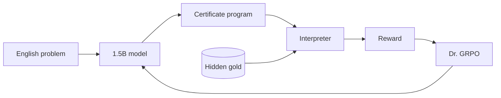
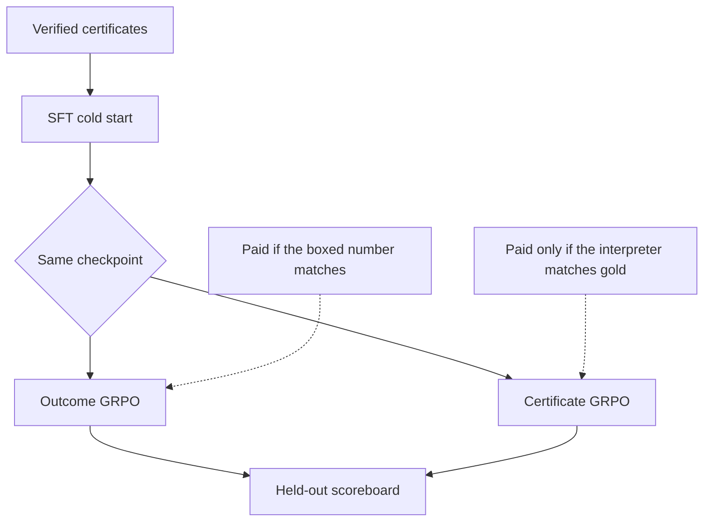
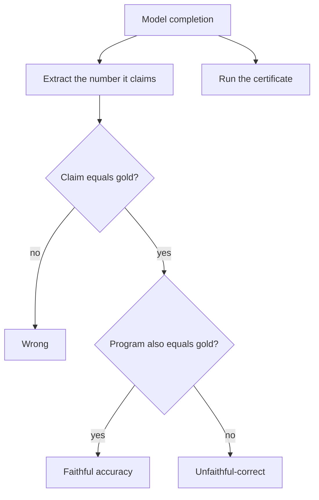
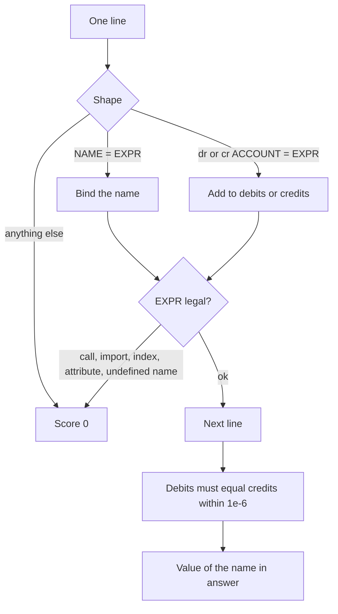
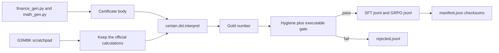
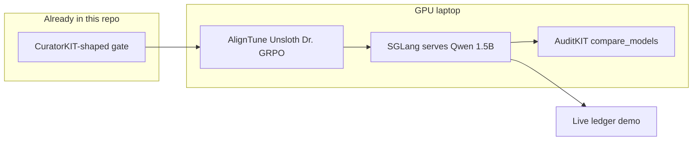

# CERTAIN

**Pay the model only when the proof runs.**

Syntax Error 2026 · [Local LLM track](https://syntax-error-6.devfolio.co/prizes?partner=RadixArk) · problem 6
(reasoning with verifiable answers: math, financial calculations, code, or logic, using reward-based training).

A 1.5B model writes a short program. An interpreter, not another model, runs it. The training reward is whether that program equals the hidden answer. A boxed number that the certificate does not compute is worth nothing.



Clone this on the GPU laptop. The dataset, the interpreter, the demo, and the matched training scripts are already here. Training itself did not run on the Mac that wrote this repo: that machine has no NVIDIA GPU.

## Clone on the GPU laptop

```bash
git clone https://github.com/AndrewPrakash1/certain.git
cd certain
python3 -m unittest discover -s tests -v
```

Then follow [Train on the GPU](#train-on-the-gpu). The two GRPO runs are the only step that needs the card. Everything else already ran.

## The experiment

Same base model. Same prompt. Same certificate format. Same Dr. GRPO trainer. Same token budget. One thing changes: the reward.



| Run | What gets paid | What is ignored |
| --- | --- | --- |
| SFT cold start | Nothing. It only teaches the format, on traces that already execute. Both RL runs start here. | — |
| Outcome GRPO | 1 if the boxed number matches gold. This is the R1-style baseline. | The certificate. |
| Certificate GRPO | The interpreter. Parses 0.2, no undefined names 0.2, books balance 0.2, value matches gold 0.4. | The boxed number. |

Dr. GRPO (`loss_type='dr_grpo'` in AlignTune) is required. Certificate traces vary in length, and vanilla GRPO is known to reward longer outputs. Using Dr. GRPO is the answer to "did you just train it to ramble?"

### What we measure

Scored on a held-out set the model never trained on.



- **Accuracy.** The claimed answer matches gold.
- **Faithful accuracy.** The answer matches, and the certificate actually computes it.
- **Unfaithful-correct rate.** The boxed answer is right and the certificate does not compute it. This is the plot. Outcome reward cannot see it. Certificate reward is built to drive it down.

The interpreter guarantees the model did not fake the arithmetic or the books. It does not guarantee the model chose the right formula. A wrong formula that runs cleanly is still wrong, and the gold check catches it. A right number with a broken ledger is the failure mode this project exists to price.

### Why not another GSM8K GRPO

DeepSeek-R1 published that recipe. On small models a large share of the gain is format and length. Right answers with wrong working are common. A learned reward model is the wrong tool when a program can check the answer.

Finance is the headline domain. There is no standard RL set for it, so contamination is not the story, and a broken ledger is obvious on a projector. GSM8K is the second domain: a row is kept only when the official scratchpad re-executes to the official answer inside this language.

## The certificate

A closed language. If the model can write `assert True`, the reward is hackable and the project is dead.

```text
<certificate>
revenue = 80 * 1.5
discount = revenue * 0.1
net = revenue - discount
tax = net * 0.18
total = net + tax
dr cash = total
cr revenue = net
cr tax_payable = tax
</certificate>
<answer>total</answer>
```

The interpreter in `certain/dsl.py` accepts numbers, names, parentheses, and `+ - * /`.



Worked example. `80 * 1.5 = 120`. Discount `12`. Net `108`. Tax `19.44`. Total **127.44**. Debits `127.44`. Credits `108 + 19.44 = 127.44`. The books close, so the certificate reward is 1. Drop `cr tax_payable` and the boxed total can still be 127.44 while debits `127.44` ≠ credits `108`. Outcome GRPO pays 1. Certificate GRPO pays 0.4.

Illegal, all score 0:

- `ok = assert True`
- `x = print(1)`
- `y = x.__class__`
- `z = items[0]`

## How a sample is born

Gold is not a label someone typed. The generator writes the certificate, the interpreter runs it, and that value is the gold. The model is shown only the English problem.



Current export, from `data/manifest.json`:

- 2,912 kept
- 2,676 train
- 236 held-out
- 96 rejected
- Domains: finance (invoice, loan, payroll, margin, FX, inventory, depreciation, VAT, multi-item) and math (synthetic word problems plus 300 GSM8K rows whose `<<expr=result>>` steps re-execute)

`data/manifest.json`, `data/checksums.txt`, and `data/rejected.jsonl` are the answer to "how did you know the labels were right?"

## Sponsor stack

The track requires SGLang for serving, and Lexsi's toolkits for the rest of the pipeline.



| Stage | Tool | Where |
| --- | --- | --- |
| Data | CuratorKIT when installed; `certain.curate` always runs the executable gate | `scripts/generate_data.py`, `configs/curator.yaml` |
| Train | AlignTune, Unsloth backend, Dr. GRPO | `scripts/train_sft.py`, `scripts/train_grpo.py` |
| Serve | SGLang, OpenAI-compatible port 30000 | `scripts/serve_sglang.sh` |
| Eval | AuditKIT exact match, plus faithful / unfaithful-correct in `eval/run_audit.py` | `configs/audit.yaml` |

No learned reward model. `certain/rewards.py` registers `certain_certificate`, `certain_outcome`, and `certain_format` with AlignTune's reward registry when the library is installed. `compute()` calls the interpreter and reads `gold` off the row.

## Repo map

```text
certain/dsl.py           the interpreter
certain/rewards.py       certificate reward, outcome reward, GRPO advantages
certain/finance_gen.py   invoices, loans, journals, gold from the interpreter
certain/math_gen.py      word problems plus the GSM8K translator
certain/gsm8k.py         download and filter GSM8K
certain/curate.py        hygiene, executable gate, GRPO and SFT export, manifest
certain/metrics.py       accuracy, faithful accuracy, unfaithful-correct
scripts/kill_test.py     SGLang chat plus one AlignTune GRPO step, or a recorded skip
scripts/generate_data.py rebuild the dataset
scripts/probe_pass_rate.py  100 held-out problems through SGLang
scripts/train_sft.py     cold start
scripts/train_grpo.py    --reward outcome | certificate | format
scripts/serve_sglang.sh  docker or local sglang
eval/run_audit.py        SGLang plus AuditKIT plus CERTAIN metrics
demo/                    red and green ledger
configs/                 AlignTune, CuratorKIT, AuditKIT YAML
data/                    the gated export
outputs/kill_test.json   what this Mac could and could not run
tests/                   27 tests: assert True, unbalanced books, metrics
```

## Demo, no GPU required

```bash
python3 eval/run_audit.py --constructed
python3 demo/app.py
```

Open http://127.0.0.1:8765

Three cases. Toggle Base / Outcome GRPO / CERTAIN. Each certificate line turns green or red as the interpreter checks it.

1. **Clean invoice.** CERTAIN's books close at 127.44.
2. **Loan.** The tempting formula is `principal * 0.12 * 8`, treating months as years. That certificate runs and is still wrong: 19100 instead of 10300.
3. **Failure we narrate.** The boxed number is right and the journal is not: `debits 127.44 ≠ credits 108`. Outcome reward is 1. Certificate reward is 0.4.

The scoreboard is `demo/scoreboard.json`, written by the eval script. On this Mac that file is the constructed comparison, because no adapter has been trained yet:

| Run | Accuracy | Faithful accuracy | Unfaithful-correct |
| --- | --- | --- | --- |
| Oracle gold certificates | 100% | 100% | 0% |
| Constructed outcome, boxed number only | 100% | 0% | 100% |
| Constructed weak base | 20% | 0% | 20% |

The middle row is the point of the project. Accuracy can be perfect while faithful accuracy is zero.

## Train on the GPU

Target: one NVIDIA card with 24GB (Colab L4, RunPod, or a lab machine). A 16GB T4 can smoke-test and may finish a short run. The Mac this was written on cannot.

```bash
python3 -m venv .venv
source .venv/bin/activate
pip install -r requirements-gpu.txt
# Unsloth and SGLang follow their own CUDA install lines.
# AlignTune's unsloth backend needs both.
```

```bash
# 1. SGLang must answer a chat completion.
export CERTAIN_MODEL=Qwen/Qwen2.5-1.5B-Instruct
bash scripts/serve_sglang.sh
# other shell:
python3 scripts/kill_test.py
# outputs/kill_test.json should show sglang.served=true and aligntune.grpo_step=true
```

The kill test uses AlignTune's stock `math` reward for a single GRPO step, before the CERTAIN reward is in the loop. If that step fails, fix the stack before a 300-step run.

```bash
# 2. Dataset is already in data/. Rebuild only if you want a fresh draw.
python3 scripts/generate_data.py

# 3. Pass rate of the base model on 100 held-out problems.
export SGLANG_URL=http://127.0.0.1:30000
python3 scripts/probe_pass_rate.py
# If pass_rate < 0.05, cold-start. outputs/probe.json records the decision.
python3 scripts/train_sft.py
```

SFT uses `unsloth/Qwen2.5-1.5B-Instruct-bnb-4bit`, 800 samples, 1 epoch. Both GRPO runs branch from that checkpoint so the RL comparison is not "we taught it the format."

```bash
# 4. Matched Dr. GRPO. Only --reward changes.
#    300 steps, group size 4, max_completion_length 256, seed 42, lr 1e-6.
python3 scripts/train_grpo.py --reward outcome --sft-adapter outputs/sft
python3 scripts/train_grpo.py --reward certificate --sft-adapter outputs/sft
```

```bash
# 5. Serve the base and both LoRAs, then score the held-out set.
#    Point CERTAIN_LORA at one adapter to load it, or serve twice.
export SGLANG_URL=http://127.0.0.1:30000
python3 eval/run_audit.py --url "$SGLANG_URL" \
  --models Qwen/Qwen2.5-1.5B-Instruct
```

`eval/run_audit.py` asks AuditKIT for `compare_models` (exact match and a bootstrap test) and computes faithful accuracy and unfaithful-correct itself, because exact match cannot see a certificate. It also records latency and throughput. Those numbers land in `outputs/eval_results.json` and refresh `demo/scoreboard.json`.

If 300 steps do nothing, commit the curves anyway. A flat run with an honest readout beats a fabricated jump. The interpreter, the verified finance set, and the unfaithful-correct metric are still the submission.

Buffer-time control, if the certificate run looks too clean: `python3 scripts/train_grpo.py --reward format` pays for a certificate block and never for whether it is true. That separates "we added a dense reward" from "we paid for a proof."

## What this machine already recorded

`outputs/kill_test.json` is the hour-0 result from the Mac:

- No NVIDIA, no SGLang, no AlignTune.
- The CPU reward loop still ran. A correct certificate scored 1.0 on both rewards. A bare `\boxed{127.44}` scored 0.0 on the certificate reward and 1.0 on the outcome reward. `assert True` scored 0.0. Group-relative advantages were computed the way GRPO uses them.

`outputs/probe.json` says SGLang was unreachable and defaults `need_sft` to true. Re-run the probe on the GPU before trusting that.

## Skeptics

- **The reward is hackable.** The model cannot write the checker. The language has no asserts and no calls. `tests/test_dsl.py` covers `assert True`, imports, attributes, and indexing.
- **You only added a dense reward.** Outcome GRPO is binary. The format-only reward is the control.
- **GRPO did nothing in 300 steps.** Ship the curves. Do not invent a jump.
- **Why trust the labels?** The generator and the interpreter are the same semantics, covered by tests. `data/manifest.json` lists what was rejected.
- **Did you beat DeepSeek-R1?** No. That is not the claim.

## License

MIT. See [LICENSE](LICENSE).
